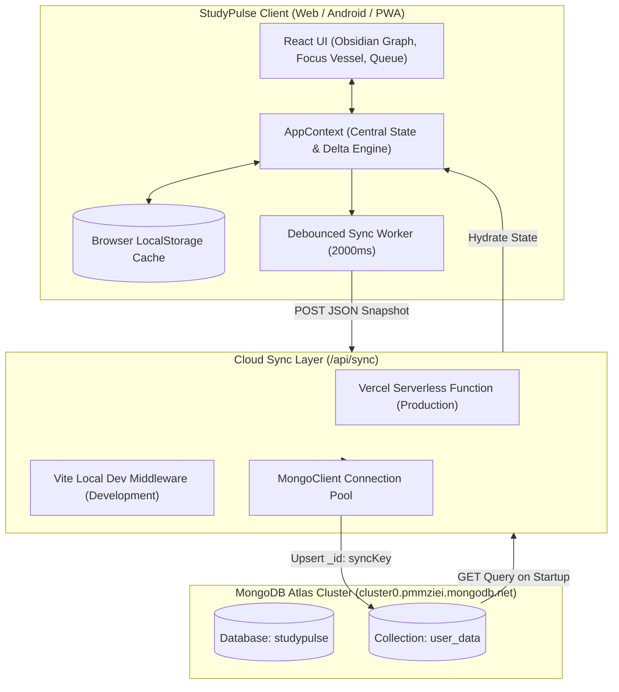
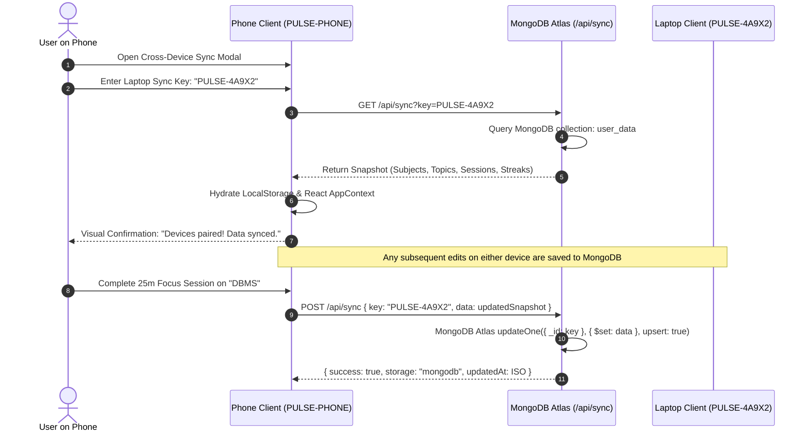
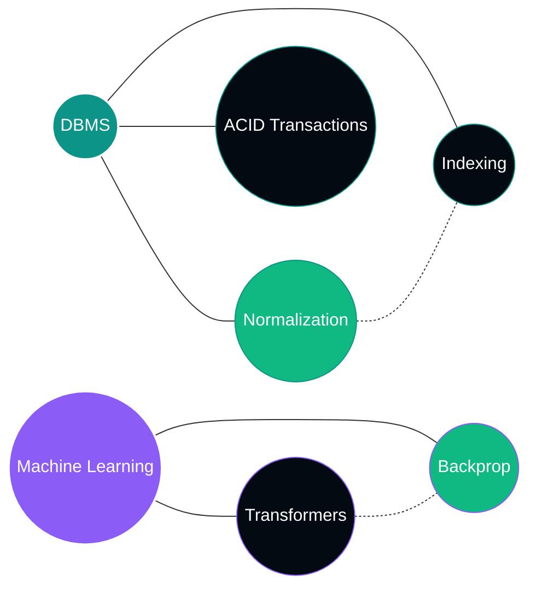

# StudyPulse: Architecture & Cloud Sync Engine

This document provides a technical walkthrough of **StudyPulse**, its **MongoDB Atlas persistence layer**, cross-device synchronization pipeline, and real-time offline-first timing architecture.

---

## 1. System Architecture Overview

StudyPulse combines **Local-First Speed** with **Cloud Resilience** backed by MongoDB Atlas.



---

## 2. Multi-Device Sync & Pairing Process

Whether you are using a desktop browser, iPhone, Android device, or tablet, StudyPulse enables seamless data synchronization.



---

## 3. MongoDB Atlas Database & Schema Structure

- **Cluster**: `cluster0.pmmziei.mongodb.net`
- **Database**: `studypulse`
- **Collection**: `user_data`

Each registered device sync room or user profile occupies a single, denormalized document for high read/write throughput:

```json
{
  "_id": "PULSE-4A9X2",
  "updatedAt": "2026-10-03T12:00:00.000Z",
  "lastClientIp": "10.166.111.95",
  "data": {
    "subjects": [
      {
        "id": "sub_1",
        "name": "DBMS",
        "color": "#0d9488",
        "weeklyTargetHours": 5,
        "createdAt": "2026-10-01T08:00:00.000Z"
      }
    ],
    "topics": [
      {
        "id": "top_1",
        "name": "Normalization (1NF to BCNF)",
        "subjectId": "sub_1",
        "approxHours": 2,
        "completedHours": 1.5,
        "status": "in_progress",
        "scheduledDate": "2026-10-03",
        "scheduledTime": "10:00"
      }
    ],
    "sessions": [
      {
        "id": "ses_1",
        "subjectId": "sub_1",
        "topicId": "top_1",
        "durationMinutes": 25,
        "durationHours": 0.42,
        "mode": "pomodoro",
        "date": "2026-10-03",
        "timestamp": "2026-10-03T10:25:00.000Z"
      }
    ],
    "streaks": {
      "currentStreak": 3,
      "longestStreak": 14,
      "lastActiveDate": "2026-10-03",
      "activityHistory": {
        "2026-10-01": 2.5,
        "2026-10-02": 3.0,
        "2026-10-03": 1.2
      }
    },
    "settings": {
      "weeklyHoursTarget": 30,
      "pomodoroWorkMinutes": 25,
      "pomodoroBreakMinutes": 5,
      "theme": "dark",
      "weekStartsOnMonday": true
    },
    "profile": {
      "name": "Alex Rivera",
      "email": "alex.rivera@gmail.com",
      "googleConnected": true,
      "googleCalendarSyncEnabled": true
    }
  }
}
```

---

## 4. Obsidian Force-Directed Graph Engine

The **Obsidian Graph View** visualizes your study curriculum as an organic constellation:



### Physics Simulation Laws:
1. **Coulomb Repulsion**:
   $$F_{\text{repulsion}} = \frac{k_{\text{repulsion}}}{d^2 + \epsilon}$$
   Every node repels all other nodes, preventing overlap and spreading subjects into orbital clusters.

2. **Hooke's Spring Law**:
   $$F_{\text{spring}} = k_{\text{spring}} \cdot (d - d_0)$$
   Connects topics to their parent subject hub and links sequential topics.

3. **Center Gravity**:
   $$F_{\text{gravity}} = -k_{\text{gravity}} \cdot \mathbf{r}$$
   Gently pulls the entire constellation towards the center of the viewport.

4. **Velocity Damping**:
   $$\mathbf{v}_{t+1} = \mathbf{v}_t \times 0.86$$
   Stabilizes the simulation smoothly into equilibrium.

---

## 5. Focus Timer: Timestamp Delta Engine

To prevent timer pauses when switching tabs or locking mobile screens:
- The engine does not rely on naive `tick - 1` increments.
- Instead, upon starting, it records an absolute finish epoch timestamp:
  $$\text{targetEndTime} = \text{Date.now()} + (\text{timeLeft} \times 1000)$$
- On every 250ms tick, as well as on `document.visibilitychange` and `window.focus`, remaining time is computed:
  $$\text{timeLeft} = \max\left(0, \left\lceil \frac{\text{targetEndTime} - \text{Date.now()}}{1000} \right\rceil\right)$$
- This guarantees $100\%$ real-world time accuracy even if the browser sleeps, the app is backgrounded, or the screen locks.
